<p align="center">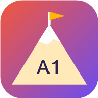</p>

# Climb English

App para que una niña de unos 10 años aprenda inglés desde cero hasta el nivel A1 **jugando**,
con la escalada, las manualidades y la música como hilo conductor.

**La app:** https://4ng318i.github.io/climb-english/

Este README es para el adulto que la instala y la mantiene, no para quien la usa.

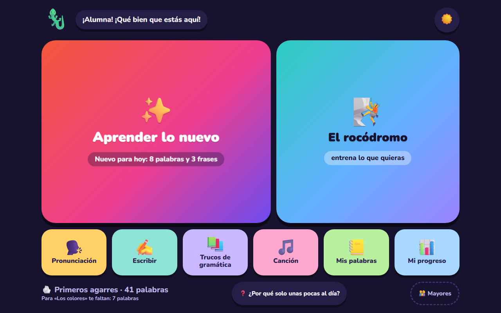

El panel abre con dos botones grandes: **aprender** (temario nuevo, a ritmo sano) y
**entrenar** (el rocódromo, sin límite).

---

## Índice

1. [Instalarla en la tablet](#1-instalarla-en-la-tablet)
2. [Qué hace ella en cada parte](#2-qué-hace-ella-en-cada-parte)
3. [Cómo leer su progreso](#3-cómo-leer-su-progreso)
4. [Copia de seguridad y cambio de tablet](#4-copia-de-seguridad-y-cambio-de-tablet)
5. [Empezar de cero](#5-empezar-de-cero)
6. [Qué NO hace la app](#6-qué-no-hace-la-app)
7. [Publicar una versión nueva](#7-publicar-una-versión-nueva)
8. [Corregir o añadir contenido](#8-corregir-o-añadir-contenido)
9. [Herramientas y pruebas](#9-herramientas-y-pruebas)
10. [Cómo está hecha](#10-cómo-está-hecha)

---

## 1. Instalarla en la tablet

Hazlo tú la primera vez; después ella ya puede usarla sola.

1. Con la tablet en wifi, abre **Chrome** y entra en https://4ng318i.github.io/climb-english/
2. Menú **⋮** → **Añadir a pantalla de inicio** (en algunas tablets, **Instalar aplicación**).
   Confirma con **Instalar**.
3. Ábrela desde el icono de la montaña. Se abre a pantalla completa, como cualquier app.
4. La primera vez pregunta el nombre. Escríbelo y toca **¡A escalar!**; después Grip, la
   lagartija, le explica el ritmo de aprendizaje.
5. Sin salir de la wifi, deja la app abierta medio minuto para que termine de guardarse todo.
   A partir de ahí funciona **sin conexión**; solo necesitan internet los vídeos de las
   canciones y el micrófono.

### Comprueba la voz inglesa (esto es importante)

La app lee en voz alta con la voz del propio Android, y **esa voz es la única referencia de
pronunciación que ella va a tener**. Compruébala antes de entregar la tablet:

1. Mantén pulsado **Mayores**, abajo a la derecha, dos segundos.
2. Mira **Voz en uso** y **Acento**: tiene que poner **británico (en-GB)**, porque las pistas
   de «suena parecido a» están escritas para ese acento.
3. Toca **Probar la voz**. Dice «I», «car» y una frase. «I» tiene que sonar «ái», y en «car»
   **no** debe oírse la r final (si se oye, la voz es americana).
4. Si falta o no es británica: Ajustes de Android → Sistema → Idiomas → **Síntesis de voz** →
   motor de Google → **Instalar datos de voz** → *English (United Kingdom)*. Descárgala, para
   que funcione también sin conexión.

Si el aparato no tiene ninguna voz inglesa, la app **se queda callada** y avisa en el panel,
antes que enseñar una pronunciación equivocada.

### Escuchar cualquier palabra (para ti, no para ella)

En **Mayores** hay un buscador de las 330 palabras del banco con su altavoz, estén
desbloqueadas o no. Sirve para comprobar cómo suena algo sin esperar a que ella llegue a esa
palabra jugando. No toca su progreso: ni descubre la palabra, ni la cuenta, ni la mete en
los repasos.

Arriba están además las tres parejas que **la app escribe igual sin serlo**, porque la
grafía no marca si una vocal es larga o corta: `a`/`are`, `am`/`arm` e `it`/`eat`. Al
tocarlas las dice seguidas, con una pausa en medio, para poder compararlas. Si en tu
dispositivo suenan idénticas, la voz no está distinguiendo la longitud y eso es un problema
de la voz, no de la grafía.

### El micrófono (opcional, apagado por defecto)

El reconocimiento de voz de Chrome **envía el audio a Google** y necesita internet. Por eso
viene apagado: la sección de pronunciación funciona en modo «escucha y repite», sin puntuar y
sin que salga nada de la tablet. Para activarlo: **Mayores → Micrófono**. Si falla o no hay
conexión, la app vuelve sola a «escucha y repite».

---

## 2. Qué hace ella en cada parte

### ✨ Aprender lo nuevo

Es el botón grande y la entrada principal. **Dice lo que va a dar**: «Aprender lo nuevo —
Nuevo para hoy: 8 palabras y 3 frases». Cuando ya no queda nada nuevo, cambia solo a
«Repasar jugando».

Lo nuevo va **siempre al principio** de cada tanda: 3 palabras nuevas o 1 frase nueva, y
después 4 minijuegos que las mezclan con repaso de días anteriores.

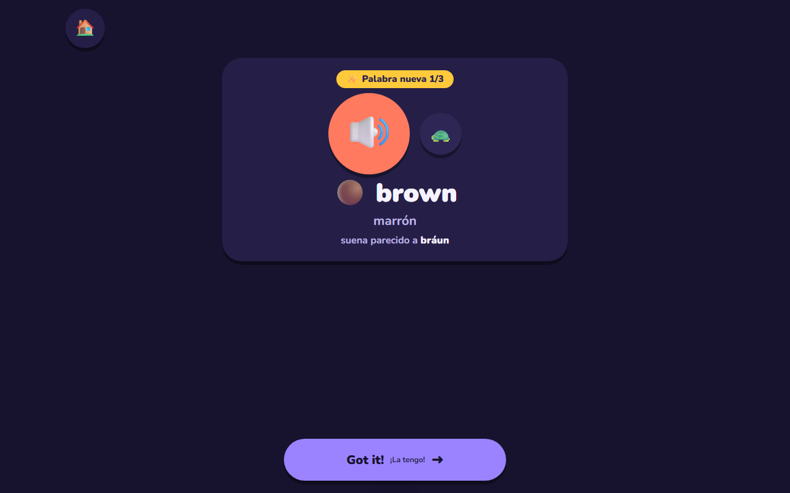

Los seis minijuegos van rotando: emparejar palabra y dibujo, cazar al intruso, ordenar una
frase, contar los golpecitos de una palabra, memory inglés-español e inventar frases tontas.
En las sesiones de aprender **la rotación es fija y no se elige**: una palabra nueva hay que
verla, oírla, escribirla y montarla, no solo reconocerla. Para elegir está el rocódromo.

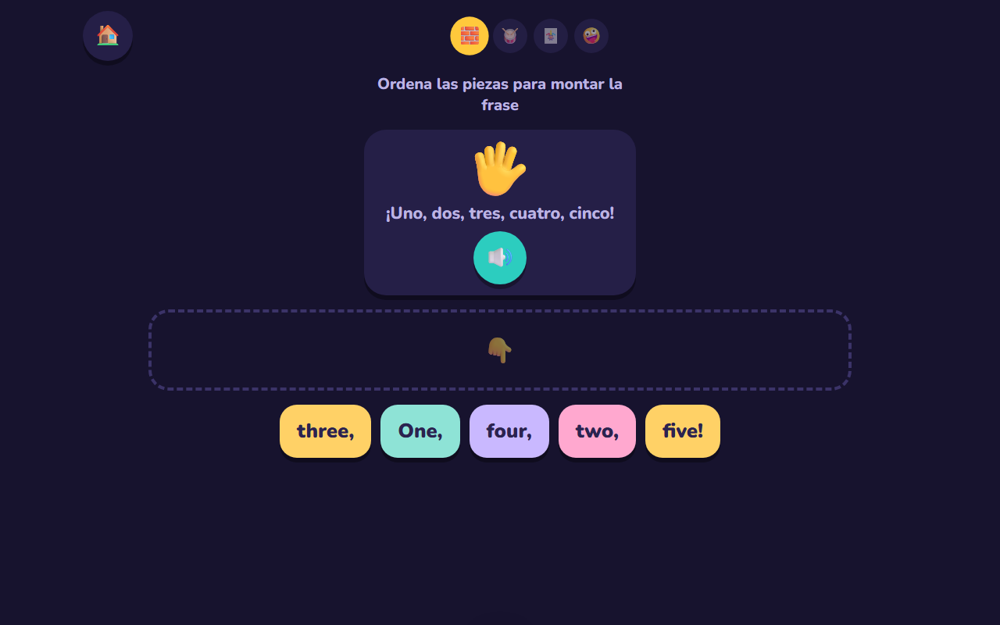

**Las tandas se encadenan.** Al terminar los juegos de una tanda, si todavía queda algo nuevo
del día, aparece un puente que dice exactamente qué falta:

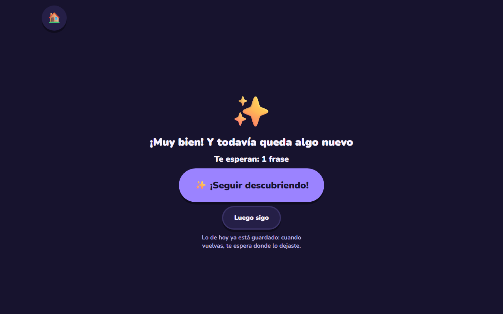

Así se llega a todo lo del día sin salir de la pantalla ni acertar con la secuencia correcta.
Y parar es igual de fácil que seguir: «Luego sigo» no es abandonar, lo descubierto ya está
guardado. Si sale a mitad, el botón del panel entrega la tanda siguiente al primer toque.

**Nunca dice que algo está mal.** Si falla, primero le dice qué le salió bien («¡tienes 3
letras perfectas!») y luego cómo queda mejor. No hay cruces rojas ni sonidos de error.

**Límite diario: 8 palabras y 3 frases nuevas**, contadas en elementos y no en sesiones:
las tandas se encadenan hasta agotar el cupo del día. Cuando
se acaba lo nuevo, el día no se acaba: puede seguir jugando con lo que ya sabe, que es
justamente el repaso que fija las palabras. La app se lo dice en positivo, y el botón
«¿Por qué solo unas pocas al día?» del panel se lo explica las veces que quiera.

### 🧗 El rocódromo

El segundo botón grande, ahí **desde el primer día**. Es donde entrena con lo que ya sabe,
sin ningún límite: partidas encadenadas hasta que ella quiera parar.

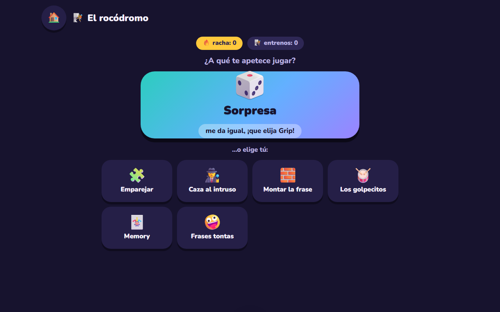

No es el premio de consolación de cuando se acaba lo nuevo, y por eso no está escondido ni
aparece solo entonces: el temario tiene su ritmo, pero **jugar no tiene techo**. Cada ronda
mezcla las palabras que hoy tocaba repasar con otras al azar, así que entrenar aquí alimenta
el mismo repaso espaciado que las partidas de aprender. Lleva su marcador de racha y de
entrenos, celebra cada cuatro partidas, y tiene su propio panel en «Mi progreso».

**Aquí sí se elige juego.** El rocódromo abre con «🎲 Sorpresa» (la opción grande, la que
viene por defecto) y, debajo, los seis minijuegos para elegir uno y repetirlo. Elegir es
posible, nunca obligatorio. No hay coste pedagógico, porque aquí se entrena lo que ya sabe.

Lo que el rocódromo **no** hace: dar palabras nuevas. Eso sigue siendo cosa del otro botón.

### 🗣️ Pronunciación

Escuchar es lo primero y lo más grande de la pantalla; la grafía española va debajo y siempre
como «suena parecido a», nunca como «se dice así».

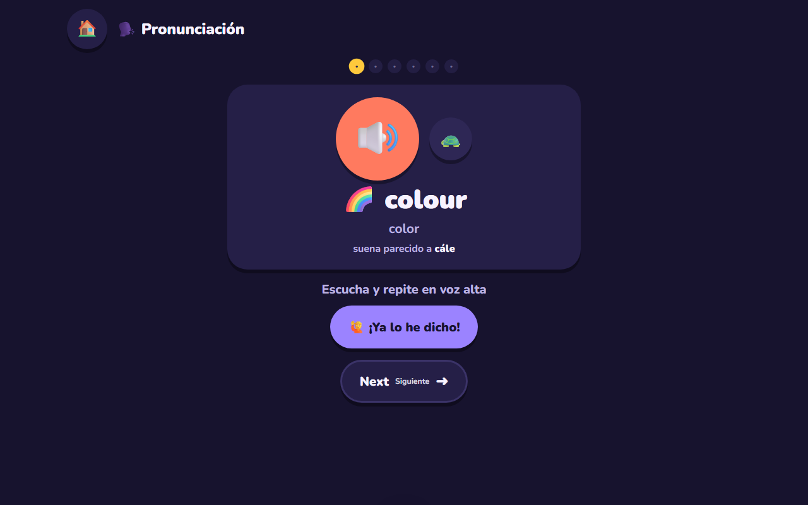

### ✍️ Escribir

Dictados muy cortos de palabras que ya domina, con teclado grande en pantalla.

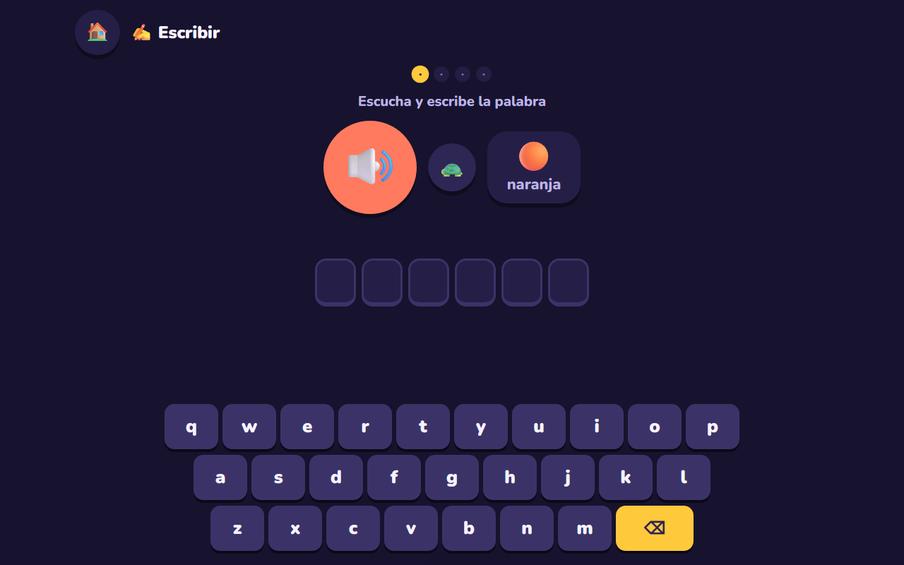

### 📚 Trucos de gramática

**95 fichas en total: 18 reglas y 77 trucos.** Al día se abren como mucho **una regla y dos
trucos**: la regla monta frases («la palabrita que acompaña», nunca «verbo auxiliar») y el
truco es un hallazgo suelto y corto, del tipo «la b de *climb* no se oye» o «*to*, *too* y
*two* suenan igual». Todo con dibujos y sin tecnicismos. Las ya vistas se pueden repetir
siempre; las que aún no tocan aparecen como regalos.

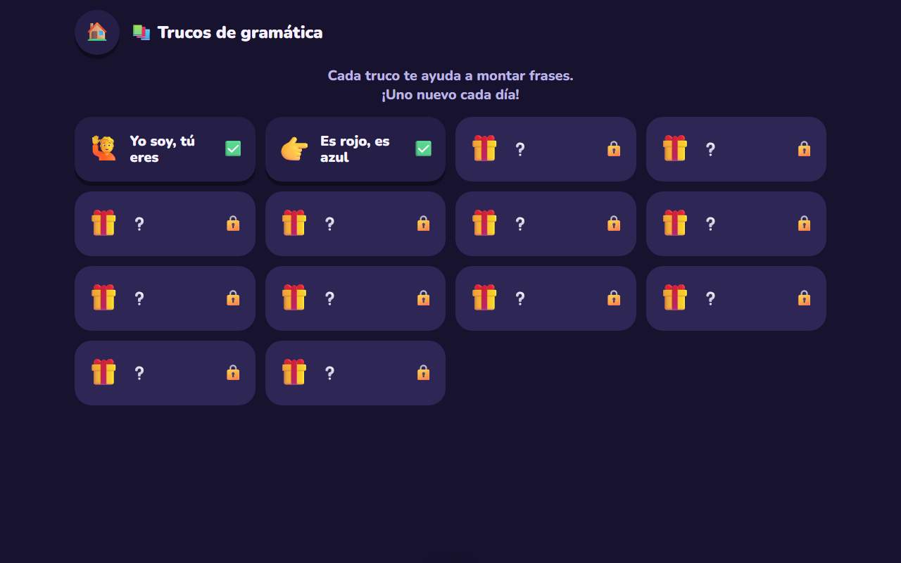

### 🎵 Canción

Canciones actuales, **sin letra** (por copyright): título, artista, enlace al vídeo oficial y
entre 5 y 8 palabras sueltas con su significado. Cada día que abre una canción se desbloquean
hasta 3 palabras nuevas.

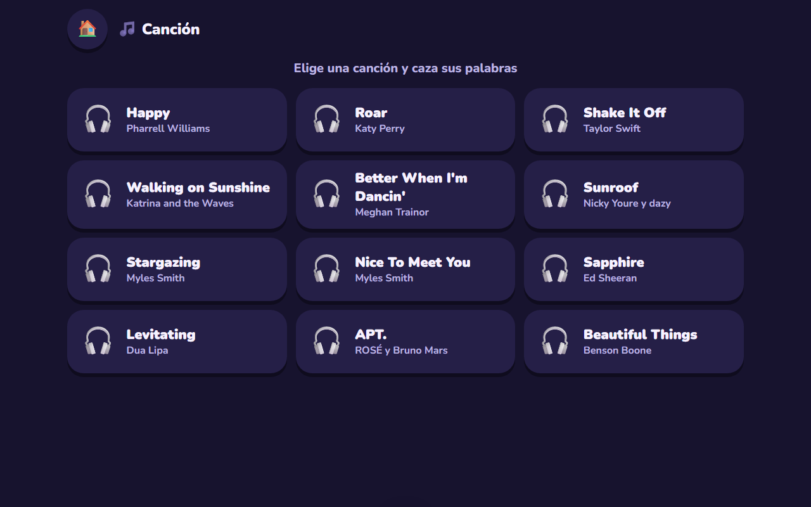

### 📒 Mis palabras

Todo lo que ha descubierto, por bloques, con significado, grafía y botón para escucharlo. No
puntúa nada: es para mirar cuando le apetezca. ⭐ «me la sé» o 🌱 «creciendo».

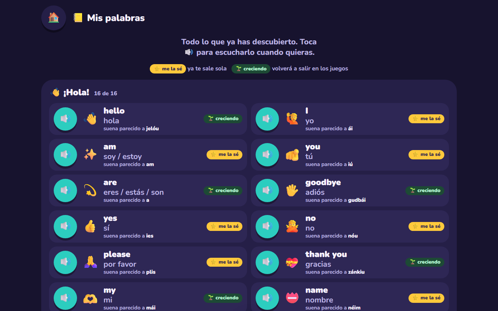

---

## 3. Cómo leer su progreso

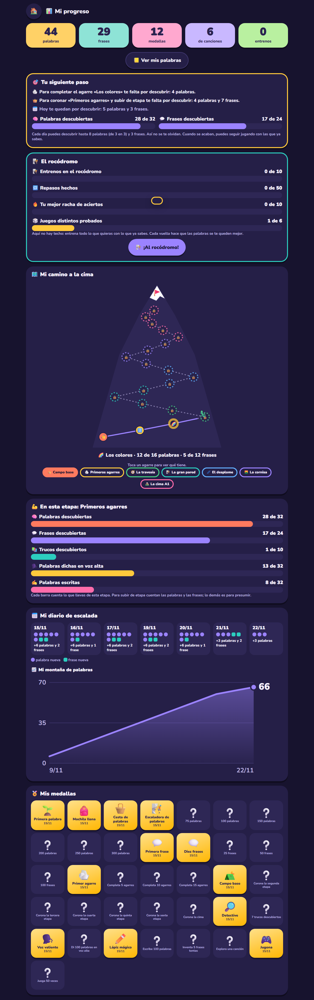

De arriba abajo:

- **Los cinco números.** Palabras, frases y medallas conseguidas, las palabras que vienen de
  canciones (que no cuentan para el camino, ver más abajo) y los entrenos del rocódromo.
- **El rocódromo.** Entrenos, repasos hechos, su mejor racha de aciertos y cuántos minijuegos
  distintos ha probado.
- **Tu siguiente paso.** Lo más útil para ti: dice con números exactos qué falta para
  completar el agarre actual y para subir de etapa, y qué le queda nuevo para hoy.
- **Mi camino a la cima.** La montaña. Cada agarre es un bloque temático (20 en total) y cada
  color, una etapa (7). Tocando un agarre se ve cuánto lleva de él. **La lagartija no se
  agarra al bloque: va por el sendero**, en el punto exacto que le toca según las palabras
  que lleva de ese bloque, y llega al agarre siguiente justo cuando lo completa. Al abrir el
  mapa sube deslizándose desde donde se quedó la última vez, con el trozo ya subido pintado
  detrás, para que el avance del día se vea. A 8 palabras al día cruza medio tramo diario.
- **En esta etapa.** Cinco barras, todas contadas sobre el total de la etapa («3 de 64»), sin
  porcentajes sueltos. Para subir de etapa solo cuentan palabras y frases; trucos, voz y
  escritura son para presumir.
- **Mi diario de escalada.** Un sello por cada día que ha jugado, con un punto por palabra y
  un cuadradito por frase. **Los días que no entra no aparecen**: no hay rachas que romper. A
  partir de cuatro días con palabras nuevas aparece además una gráfica.
- **Mis medallas.** 36 en total; las que faltan se ven en gris con la pista de cómo lograrlas.

### El camino a A1

Subir de etapa pide descubrir **todas las palabras y todas las frases** de sus bloques.

| Etapa | Bloques | Palabras | Frases del camino | De práctica | Días mínimos | Interfaz en inglés |
|---|---|---|---|---|---|---|
| 1 Campo base | 1 | 16 | 6 | 6 | 2 | 0 % |
| 2 Primeros agarres | 2–3 | 32 | 12 | 12 | 4 | 10 % |
| 3 La travesía | 4–5 | 33 | 12 | 12 | 5 | 20 % |
| 4 La gran pared | 6–8 | 51 | 18 | 18 | 7 | 30 % |
| 5 El desplome | 9–11 | 52 | 18 | 18 | 7 | 45 % |
| 6 La cornisa | 12–15 | 66 | 24 | 24 | 9 | 60 % |
| 7 La cima A1 | 16–20 | 80 | 30 | 30 | 10 | 70 % |
| **Total** | **1–20** | **330** | **120** | **120** | **44** | **70 %** |

**Las frases van en dos grupos.** Las *del camino* son las que hay que descubrir para subir
de etapa. Las *de práctica* son otras tantas que salen en los juegos y en el rocódromo pero
no cierran nada: están para que haya material de sobra con el que repasar sin que las frases
se conviertan en el cuello de botella.

Al ritmo máximo (8 palabras y 3 frases al día), el camino entero son unas seis semanas. La
primera etapa es corta a propósito: es la que decide si sigue o lo deja.

**La interfaz se va pasando al inglés sola.** Empieza todo en español y, al coronar cada
etapa, parte de los textos cambian a inglés (primero los más repetidos: «¡Muy bien!» →
«Great!»). Las primeras veces, el español aparece en pequeñito debajo. Llega hasta el 70 %.

### Celebraciones

Las hay en cuatro escalas, para que nunca pasen muchos días sin una: al terminar cada partida,
al completar cada agarre (unos tres días), al coronar cada etapa y con cada medalla.

---

## 4. Copia de seguridad y cambio de tablet

El progreso vive **solo en esa tablet**, en el almacenamiento local de Chrome. Si se borran los
datos del navegador o se desinstala la app, se pierde. No hay servidor ni cuenta.

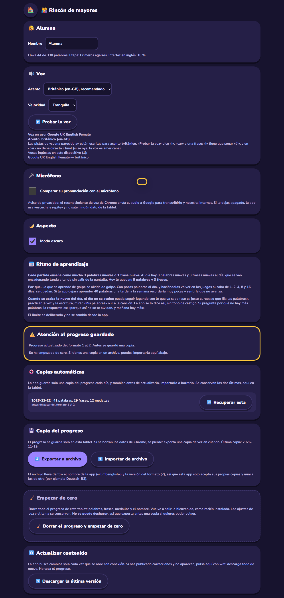

En **Mayores → Copia del progreso**:

- **Exportar a archivo** descarga `climbenglish-<nombre>-<fecha>.json` en la carpeta Descargas.
- **Importar de archivo** lo recupera, pidiendo confirmación antes de sustituir nada.

El archivo lleva dentro el nombre de la app y la versión del formato, así que la app **rechaza
los archivos de otras apps** (por ejemplo los de Deutsch_B2) con un mensaje claro, en lugar de
cargarlos y romperse.

**Para pasar el progreso a otra tablet:**

1. En la tablet vieja: Mayores → **Exportar a archivo**.
2. Pasa el `.json` a la nueva (correo, nube, cable; es un archivo de texto pequeño).
3. En la tablet nueva: instala la app como en el apartado 1, escribe el nombre, y luego
   Mayores → **Importar de archivo** → elige el archivo → **Sí, importar**.

Conviene exportar de vez en cuando y guardar el archivo fuera de la tablet. **Ese archivo
contiene el nombre de la niña: no lo subas a este repositorio** (el `.gitignore` ya lo excluye).

---

## 5. Empezar de cero

**Mayores → Empezar de cero** borra todo el progreso de esa tablet (palabras, frases, medallas
y el nombre) y vuelve a salir la bienvenida, como recién instalada. Pide confirmación y **no se
puede deshacer**; los ajustes de voz y el tema se conservan.

Sirve para probar la app desde el principio, o para dejarla limpia si algo se ha torcido.

---

## 6. Qué NO hace la app

Para que no haya sorpresas:

- **No recoge ningún dato.** No hay cuenta, ni servidor, ni analítica, ni publicidad. El nombre
  y el progreso no salen de la tablet. Nadie, yo incluido, puede ver desde fuera cómo le va.
- **No corrige la pronunciación de verdad.** Con el micrófono apagado (lo normal) no escucha
  nada: ella repite y la app la anima. Con el micrófono encendido usa el reconocimiento de voz
  de Chrome, que es generoso y manda el audio a Google.
- **No enseña a conversar.** Es vocabulario, frases hechas, gramática básica y pronunciación de
  A1. No hay diálogo libre ni corrección de textos escritos por ella.
- **No tiene letras de canciones** (copyright): solo palabras sueltas y el enlace al vídeo
  oficial. Si un vídeo no permite incrustarse, queda el enlace para abrirlo en YouTube.
- **No pone deberes, horarios ni rachas.** Si deja de entrar tres días, al volver la recibe
  igual de bien; no hay contadores que se rompan.
- **No deja avanzar más rápido.** El límite diario es deliberado y no se puede cambiar desde la
  app: lo que se aprende de golpe se olvida de golpe.
- **No es un sustituto de clase ni de hablar con alguien.** Es la referencia que ella no tiene
  en casa, no un profesor.
- **No filtra YouTube.** El vídeo se abre dentro de la app con `youtube-nocookie.com`, pero si
  hay que abrirlo en YouTube (el plan B cuando no se puede incrustar), ya es YouTube con todo
  lo que eso trae.

---

## 7. Publicar una versión nueva

Desde la carpeta del proyecto:

```sh
python tools/validate.py          # comprueba el contenido de data/
git add -A
git commit -m "Corrijo grafías del bloque 4"
git push
```

GitHub Pages tarda uno o dos minutos. **Al tocar cualquier archivo que se sirva hay que subir
`VERSION` en `sw.js`**; el hook de pre-commit no te dejará hacer el commit si se te olvida, y
te dirá qué número poner. En un clon nuevo, actívalo una vez:

```sh
git config core.hooksPath .githooks
```

### Cómo llega el cambio a la tablet

La app busca novedades sola: al abrirla, al volver a ella (desbloquear la tablet, cambiar de
app) y al recuperar la conexión. Cuando encuentra una versión nueva la instala en segundo plano
y la aplica **en un momento seguro**: al abrir la app o al salir de una partida, nunca en mitad
de un juego. No hay ningún botón de «recargar» que ella tenga que pulsar.

Sin conexión no pasa nada: falla en silencio y lo reintenta la próxima vez.

Si has publicado algo y no aparece, con wifi: **Mayores → Actualizar contenido → Descargar la
última versión**. No toca el progreso. **No** uses «Borrar datos del sitio» de Chrome para
esto: eso sí borra el progreso.

### Convivencia con las otras apps del mismo GitHub

Todas las apps de `4ng318i.github.io` comparten origen, y con él el almacenamiento y las
cachés del navegador. Por eso aquí:

- las claves de almacenamiento empiezan por `climbenglish:`;
- las cachés se llaman `climbenglish-vN` y el service worker **solo borra las suyas**;
- los archivos de copia llevan el nombre de la app dentro.

`tools/e2e.py` comprueba precisamente esto: siembra datos y cachés de otra app y verifica que
siguen intactos después de instalar y de actualizar.

---

## 8. Corregir o añadir contenido

Todo el contenido está en `data/`, separado del código. Después de editar:

```sh
python tools/validate.py
```

Avisa si falta una coma, un campo o si hay un identificador repetido.

### Corregir una grafía

Abre el archivo del bloque en `data/blocks/` y cambia el campo `pron`.

### Cómo se escribe la grafía (`pron`)

Es una muleta visual: quien manda es la voz. Se escribe para que una niña de 10 años la lea tal
cual, y sigue el **inglés británico**:

- Solo letras y sonidos del español, sin vocales dobles ni signos raros.
- La tilde marca el golpe de voz: `uóte` (water), `guitá` (guitar).
- La **r detrás de vocal no suena** y no se escribe: `ca` (car), `fo` (four), `gáden` (garden).
  Al final de palabra, `-er` suena como una «e» floja: `uóte`, `síste`, `tíche`.
- Excepción: la vocal de *bird*, *girl*, *word* no existe en español y se escribe `er`
  (`berd`, `guerl`, `uerd`). Esa r sobra: la voz británica no la dice, y es ella quien enseña.
- `z` es la zeta española (three = `zri`), `j` una jota muy suave (hello = `jelóu`), `sh` como
  para pedir silencio, `y` como en «yo» dicho con fuerza (jump = `yamp`).
- Las letras mudas no se escriben: `cláim` (climb), `lísen` (listen), `nóu` (know).
- Es normal que dos palabras queden escritas igual (`am` vale para *am* y *arm*): el español no
  tiene esos sonidos y la diferencia la enseña la voz.

### Si la voz lee mal una palabra suelta (`say`)

Algunas voces pronuncian mal ciertas palabras aisladas; la «I» suelta, por ejemplo, puede sonar
«i». Añade el campo opcional `say` con el texto que se le dará a la voz; en pantalla se sigue
viendo la palabra de verdad:

```json
{"id": "w-i", "en": "I", "say": "eye", "es": "yo", "pron": "ái"}
```

### Una canción nueva — `data/songs.json`

Copia un bloque entero y cambia los datos. **No pongas la letra**, solo de 5 a 8 palabras:

```json
{
  "id": "nombre-corto-sin-espacios",
  "title": "Título de la canción",
  "artist": "Artista",
  "youtube": "https://www.youtube.com/watch?v=XXXXXXXXXXX",
  "words": [
    {"en": "dance", "es": "bailar", "pron": "dans", "emoji": "💃"}
  ]
}
```

Las palabras de canciones **no cuentan para el camino a A1** (no son temario A1 y cambian con
cada canción que añadas), pero se guardan y se ven en «Mi progreso» y en «Mis palabras».

**Para quitar una canción no la borres**: ponle `"retired": true`. Desaparece de la lista, pero
las palabras que ya se hubieran desbloqueado siguen contando y se siguen viendo en
«Mis palabras». Borrarla del archivo sí las haría desaparecer de su progreso.

### Una palabra nueva — `data/blocks/NN-nombre.json`, lista `words`

```json
{"id": "w-kite", "en": "kite", "es": "cometa", "pron": "cáit", "pos": "nombre",
 "block": 19, "emoji": "🪁", "syllables": 1, "stress": 1, "theme": "manualidades"}
```

| Campo | Qué es |
|---|---|
| `id` | Único en toda la app: `w-` + la palabra en minúsculas con guiones. |
| `en`, `es` | Inglés y español. |
| `pron` | Cómo suena, en grafía española (ver arriba). |
| `pos` | `nombre`, `acción`, `cualidad`, `número`, `palabrita`, `persona`, `saludo`, `pregunta` o `día`. Las cuatro primeras se usan como huecos en las frases tontas. |
| `block` | Número del bloque (el mismo que el archivo). |
| `emoji` | El dibujo. Que no se repita dentro del mismo bloque. |
| `syllables`, `stress` | Golpecitos de la palabra y cuál suena más fuerte (juego del tambor). |
| `theme` | Opcional: `escalada`, `manualidades` o `musica`. |
| `say` | Opcional: qué darle a la voz si lee mal la palabra suelta. |

### Una frase nueva — mismo archivo, lista `sentences`

```json
{"id": "s-i-fly-my-kite", "en": "I fly my kite.", "es": "Vuelo mi cometa.",
 "pron": "ái flái mái cáit", "block": 19, "emoji": "🪁",
 "words": ["w-i", "w-fly", "w-my", "w-kite"]}
```

`words` son las palabras que hay que conocer antes de ver la frase; solo de ese bloque o de
anteriores. `grammar` (opcional) es el `id` de la regla que ilustra. Si escribes `{name}` en una
frase, la app pone ahí el nombre guardado en la tablet.

### Un bloque nuevo

1. Crea `data/blocks/21-lo-que-sea.json` copiando la forma de otro.
2. Añádelo a la lista `blocks` de `data/blocks.json` con su `n`, `file`, `stage`, `title` y `emoji`.

### Lo demás

- `data/grammar.json` — reglas: la idea (sin tecnicismos), los ejemplos (`scenes`) y el juego
  de huecos (`play`; el hueco se escribe `___`).
- `data/silly.json` — moldes de las frases tontas.
- `data/medals.json` — medallas. `rule.type`: `words`, `sentences`, `stages`, `blocks`,
  `grammar`, `said`, `written`, `silly`, `songs` o `sessions`.
- `data/ui-strings.json` — todos los textos de la interfaz, en español e inglés. `from` es el
  porcentaje de inglés a partir del cual se muestra en inglés (10, 20, 30, 45, 60 o 70; con 100
  se queda siempre en español).
- `data/blocks.json` — etapas y bloques. `english` es el porcentaje de inglés de cada etapa y
  `sentencesPerDay` las frases nuevas al día.

---

## 9. Herramientas y pruebas

Todas se lanzan desde la carpeta del proyecto.

| Orden | Qué hace |
|---|---|
| `python tools/validate.py` | Valida el contenido de `data/`. Ver abajo todo lo que comprueba. |
| `python tools/check_version.py` | Dice si hace falta subir `VERSION` en `sw.js`. |
| `python tools/test_check_version.py` | Prueba lo anterior y el hook en un repositorio temporal. |
| `python tools/e2e.py` | Prueba la app entera en Chromium: convivencia con otras apps, prefijos, copia de seguridad, borrado, sin conexión, actualización automática, llegar a todo lo nuevo del día, el rocódromo y la lagartija del mapa. |
| `python tools/e2e.py --solo=lagartija` | Una sola sección, en segundos. Admite `tandas`, `gym`, `lagartija` y `migracion`. |
| `python tools/screenshots.py` | Regenera las capturas de este README con un progreso de demostración. |

La batería entera tarda unos minutos: para un retoque de una pantalla usa `--solo=`, y deja
la completa para antes de publicar.

**Qué comprueba `validate.py`**, además de los campos, las referencias y los ids repetidos:

- **La regla de las 3k.** La frase número *k* del camino de un bloque solo puede usar
  palabras que estén entre las primeras *3k* de ese bloque. Así ninguna frase pide palabras
  que todavía no ha visto.
- **El texto de cada frase, no solo su lista `words`.** «My name is {name}» declaraba tres
  palabras y colaba `is`, que es de otro bloque. Ahora se mira palabra por palabra el texto
  en inglés. Acepta plurales y la `-s` de he/she si la base ya se conoce.
- **Que la grafía no se contradiga.** Una frase tiene que escribir cada palabra igual que su
  ficha, y ninguna puede llevar vocales dobles. Se colaron 55 frases con la grafía vieja
  (`aa` por *are*, `beeds` por *birds*) al quitar las vocales dobles de las fichas.
- **Que no haya alfabeto fonético.** Ningún texto que ella lea puede llevar símbolos como
  `æ` o `ə`: la grafía se escribe con letras españolas y el sonido se explica con palabras.
- **Que la voz solo diga inglés.** La app leía en alto la respuesta de los juegos de los
  trucos, y en las preguntas sueltas esa respuesta está en español («No, calla») o es una
  grafía («uóte» en lugar de *water*): la voz recitando la muleta visual en vez de la
  palabra. Ahora la respuesta no se lee nunca; cada juego declara en `say` qué inglés debe
  decir la voz, y el validador comprueba que ese `say` —y los ejemplos de las fichas, y el
  `say` de las palabras— estén dentro del vocabulario que la app puede pronunciar.


### El vocabulario que la voz puede decir

La defensa contra leer español en alto no es adivinar el idioma, es una **lista cerrada**.
La app solo pronuncia palabras que estén en el banco, en los textos de las frases, en las
canciones o en `data/speakable-extra.json`. Lo demás no se dice y queda un error en la
consola. La misma regla vive en dos sitios, `js/core/speech.js` (`isEnglish`) y
`tools/validate.py`: **si tocas una, toca la otra**.

**`data/speakable-extra.json` es el punto frágil de todo esto.** Son palabras inglesas
legítimas que un truco necesita demostrar y que no son vocabulario del camino: hoy solo
`climber` y `reader`, que los trucos del `-er` construyen a partir de *climb* y *read*.

> La lista de extras **nunca** se usa para hacer callar al validador. Si algo no suena y la
> tentación es añadirlo ahí, casi siempre es que había que decir otra cosa: la palabra
> inglesa de la que trata la pregunta, no su explicación en español ni su grafía. Una
> entrada nueva tiene que ser inglés de verdad y venir con su razón escrita al lado.

Las órdenes de `e2e.py` y `screenshots.py` necesitan Playwright:

```sh
pip install playwright
python -m playwright install chromium
```

Para verla en el ordenador (no vale abrir `index.html` a pelo):

```sh
python -m http.server 8000
```

y entra en `http://localhost:8000`.

---

## 10. Cómo está hecha

HTML, CSS y JavaScript sin compilar, sin dependencias y sin backend. Es una PWA: se instala y
funciona sin conexión.

```
index.html, manifest.json, sw.js     página, datos de instalación y modo sin conexión
css/        base.css · components.css · games.css
js/app.js                            arranque y navegación
js/core/    store (progreso, esquema y migraciones) · backup · content · srs (repaso)
            session · path (etapas, límites y medallas) · i18n (paso al inglés)
            speech (voz y micro) · updates (versión nueva) · nav · theme · util
js/ui/      feedback (ánimos, confeti) · layout · charts (gráficas SVG) · keyboard · nextstep
js/screens/ welcome · home · play · gym (rocódromo) · pronunciation · writing · grammar
            song · words · progress · settings
js/games/   match · intruder · scramble · taps · memory · silly
data/       todo el contenido (ver apartado 8)
assets/     iconos y la fuente Nunito (licencia SIL Open Font License)
docs/img/   capturas de este README, generadas por tools/screenshots.py
tools/      validate.py · check_version.py · test_check_version.py · e2e.py · screenshots.py
.githooks/  pre-commit
```

Detalles que conviene saber si vuelves a tocarlo:

- **Todas las rutas son relativas**, para que funcione igual en la raíz de un dominio que en la
  subcarpeta de GitHub Pages. No metas rutas que empiecen por `/`.
- **Si añades un archivo** en `js/` o `css/`, apúntalo en la lista `ASSETS` de `sw.js`, o no
  estará disponible sin conexión. Los de `data/blocks/` no hace falta: el service worker los
  descubre leyendo `data/blocks.json`.
- **El progreso guardado lleva su versión de esquema** en el campo `v`. Si algún día cambia el
  formato, sube `SCHEMA` en `js/core/store.js` y añade el paso correspondiente a `MIGRATIONS`;
  el mecanismo ya está puesto, hoy sin ninguna migración. Un progreso de una versión más nueva
  de la app no se sobrescribe nunca.
- **Repaso espaciado:** cada palabra vive en una caja de 1 a 5 y vuelve a los 1, 2, 4, 8 o 16
  días, siempre dentro de un juego. Un fallo baja una caja, y eso no se muestra en ningún sitio.
- **Las partidas no se alargan con el tiempo.** Cada minijuego tiene un tamaño fijo: emparejar
  4 parejas, intruso 4 rondas, frase revuelta 2 frases, golpecitos 3 palabras, frases tontas
  hasta 3, y memory 4 parejas (6 a partir de la etapa 4). Una sesión ve como mucho 8 palabras,
  tenga ella 10 o 330. Lo único que crece es al principio, mientras no hay material suficiente
  para llenar esos tamaños.
- **Los emojis** se ven con el diseño de cada aparato; alguno muy reciente puede no existir en
  una tablet antigua. Si ves un cuadrado vacío, cambia ese emoji en el JSON.
